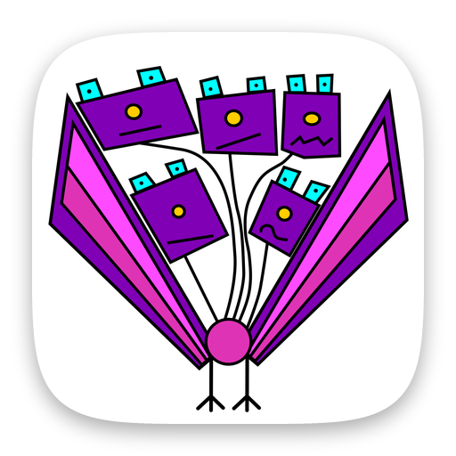

  

<h1 align="center">5Y Habit Tracker: Art Edition</h1>

A habit tracker for the long run. Every year you keep a habit reveals a new painting. 
The AI chat runs Gemma on the phone itself.

  
  &nbsp;
  

Flutter · Riverpod · ObjectBox · Gemma on-device · RevenueCat

## About the code

I built it with AI coding agents in December 2025 and January 2026.

The habit artworks are not included.

## Known issues

- There is only one smoke test.
- `flutter analyze` reports print calls, deprecations and unused imports.

© 2025–2026 Indest OÜ. All rights reserved.
